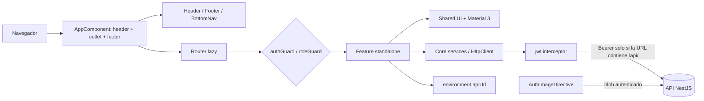

# ARCHITECTURE_CONTEXT — SIGICE Frontend Variante (`PROYECTO_GT2`, `intereses-frontend`)
> Última verificación: 2026-10-28 · Commit: `748002b` · Las reglas permanentes están en [AGENTS.md](./AGENTS.md).

1. **Resumen.** SPA Angular 20 para la Universidad del Pacífico (Buenaventura). Cubre encuesta de intereses tecnológicos, evaluación de asignaturas, capacitaciones y panel administrativo. Usuarios: `ESTUDIANTE` y `ADMIN`. Es uno de los 4 repos de SIGICE: este frontend `PROYECTO_GT2`, las variantes `PROYECTO_GT` y `PROYECTO_GT3`, y el backend NestJS `PROYECTO_GTBACKEND`. No tiene SSR: se ejecuta por completo en el navegador y consume una API HTTP absoluta. La fuente de verdad de datos, reglas y autorización es el backend.

2. **Stack verificado.**

| Tecnología | Versión | Fuente de verificación |
|---|---|---|
| Angular (core/common/forms/router/compiler/platform-browser/animations) | 20.3.34 (declarado `^20.3.0`) | `package.json`, `package-lock.json` |
| Angular Material / CDK | 20.2.14 (declarado `^20.2.0`) | `package-lock.json` |
| TypeScript | 5.9.3 (declarado `^5.5.0`) | `package-lock.json`, `tsconfig.json` |
| RxJS | 7.8.2 | `package-lock.json` |
| Chart.js / ng2-charts | 4.5.1 / 6.0.1 | `package-lock.json` |
| zone.js | 0.15.1 | `package-lock.json` |
| `@angular/build` / CLI | 20.3.40 | `package-lock.json`, `angular.json` |
| Node.js | `>=20` declarado; 22 en Docker | `package.json`, `Dockerfile` |
| nginx | 1.27-alpine | `Dockerfile` |
| Estilos | SCSS + Material 3 (paletas azul/verde/error) | `src/styles.scss`, `src/styles/_theme-material.scss` |
| Pruebas / lint / CI | No existen | `package.json`, raíz del repo |

3. **Mapa del repositorio.**

```text
.
├── src/
│   ├── main.ts                     # bootstrapApplication(AppComponent, appConfig)
│   ├── index.html                  # Inter + Material Symbols, título, favicon
│   ├── environments/environment.ts # API local vs Railway en tiempo de ejecución
│   ├── styles.scss                 # tokens → tema Material 3 → base
│   ├── styles/{_tokens,_theme-material,_base}.scss
│   └── app/
│       ├── app.component.ts        # shell: header + router-outlet + footer + bottom-nav
│       ├── app.config.ts           # router, HttpClient, interceptor, animaciones, charts
│       ├── app.routes.ts           # rutas lazy + authGuard/roleGuard
│       ├── core/                   # auth, guards, token, login-crypto, images, notificaciones, charts
│       ├── layout/                 # header, footer, bottom-nav, LayoutService
│       ├── shared/ui/              # page-header, metric-card, status-chip, empty-state, confirm, UiService
│       └── features/
│           ├── auth/               # login, recuperar, restablecer, sso-callback, sso-completar
│           ├── estudiante/         # layout con sidenav
│           ├── encuesta/           # intereses y asignaturas
│           ├── capacitaciones/     # vista del estudiante
│           └── admin/              # layout, dashboard, temas, asignaturas, periodos, capacitaciones, usuarios
├── docs/guia-de-estilo.md          # especificación visual autoritativa
├── Dockerfile / nginx.conf / proxy.conf.js
├── angular.json / tsconfig*.json / package*.json
├── AGENTS.md                       # reglas del repo
├── README.md / .gitignore
```

Puntos de entrada: `src/main.ts` (arranque), `src/app/app.routes.ts` (navegación), `src/environments/environment.ts` (API). Hay 41 archivos `.ts` y ~6.398 líneas en `src/`; los mayores son `admin/dashboard.component.ts` (861), `encuesta/encuesta-asignaturas.component.ts` (855) y `admin/usuarios.component.ts` (533).

4. **Arquitectura y capas.** No hay capas de dominio, repositorios ni NgModules de feature: es una SPA de componentes standalone con servicios singleton. Las reglas de negocio viven en el backend; el frontend aplica validaciones de UX y orquesta llamadas HTTP.

| Capa real | Responsabilidad | Ejemplos | Regla de dependencia |
|---|---|---|---|
| Shell / layout | Marco global y navegación | `src/app/app.component.ts`, `src/app/layout/` | Puede importar `core` y `shared`; nunca `features` |
| Rutas y guards | Carga lazy y control de acceso | `src/app/app.routes.ts`, `core/auth.guard.ts`, `core/role.guard.ts` | Guards → `AuthService` |
| Features | Pantallas y flujos de cada rol | `src/app/features/**` | Feature → `core`, `shared/ui`, Material |
| UI compartida | Piezas visuales reutilizables | `src/app/shared/ui/**` | No conoce features ni llama a la API |
| Core transversal | Auth, token, HTTP, imágenes, notificaciones, tema de gráficos | `src/app/core/**` | Core ↛ features; puede usar Angular/Material |
| Configuración | API base, build, estilos | `src/environments/environment.ts`, `angular.json`, `src/styles/` | Sin lógica de negocio |

Dirección permitida: `features → shared/ui + core`; `layout → core`; `core → environment/Angular`; `app → layout/features`. Está prohibido que `core` importe `features`, que `shared/ui` dependa de una pantalla concreta o que se cree un segundo mecanismo de estado global. No hay lint que imponga estos límites: son convención verificada por inspección.



5. **Convenciones y patrones (recetas reales).**

| Tarea | Receta | Ejemplo canónico |
|---|---|---|
| Página / feature | Componente standalone de archivo único (`template` y `styles` inline), `loadComponent` en rutas, `@if`/`@for`; contenedor `.pagina` + `app-page-header` | `src/app/features/encuesta/encuesta.component.ts` |
| Componente compartido | Standalone, `@Input()` simple, sin HTTP, estilos con tokens | `src/app/shared/ui/metric-card.component.ts` |
| Servicio HTTP | `@Injectable({ providedIn: 'root' })`, `inject(HttpClient)`, `signal()`/`computed()`, `toPromise()`; base en `environment.apiUrl` | `src/app/core/auth.service.ts` |
| Ruta + guard | Ruta lazy; `canActivate` en el layout; `data: { rol: 'ADMIN' }` para admin | `src/app/app.routes.ts` |
| Formulario | `ReactiveFormsModule` + `FormBuilder` + `Validators`; error inline `role="alert"`; botón deshabilitado si inválido | `src/app/features/auth/login.component.ts` |
| Avisos y confirmación | `UiService.confirmar/exito/error/info`; nunca `alert`/`confirm` | `src/app/features/admin/temas.component.ts` |
| Imagen protegida | `` o `ImagenesService`; nunca `src` directo para `/api/uploads` | `src/app/features/capacitaciones/mis-capacitaciones.component.ts` |
| Borrador local | `localStorage` con clave `sigice_*`; se limpia al enviar; excepción: no se limpia al cerrar sesión | `src/app/features/encuesta/encuesta.component.ts` |
| Estilos | Clases en español, tokens `var(--...)`, Material Symbols, Inter, breakpoints 600/900 px | `src/styles/_base.scss`, `docs/guia-de-estilo.md` |
| Prueba | **No existe patrón ni herramienta.** Al introducirla, proponer stack y obtener aprobación | — |

Formato de estado: signals locales (`cargando`, `enviando`, `error`, `fallo`) y `@if`/`@for`; no hay store global. Nombres: sufijos `Component`, `Service`, `Guard`, `Directive`; selectores `app-*`; textos de interfaz en español. El estado compartido de UI se limita a `LayoutService` (sidenav).

6. **Datos y contratos.** El frontend no persiste datos de negocio: la API es la fuente de verdad. Solo guarda en el navegador el token de sesión y borradores/estado de lectura. El backend expone Swagger en `/api/docs`, pero este frontend no usa un cliente generado ni valida el esquema en runtime: los tipos son interfaces locales y el contrato se asume.

**Endpoints consumidos** (todos se prefijan con `environment.apiUrl`).

| Método | Ruta | Dónde se usa |
|---|---|---|
| GET | `/auth/login-crypto` | `core/auth.service.ts` (`ingresar`) |
| POST | `/auth/login` | `core/auth.service.ts` (envelope cifrado) |
| GET | `/auth/me` | `core/auth.service.ts` (`cargarPerfil`) |
| POST | `/auth/recuperar` | `features/auth/recuperar.component.ts` |
| POST | `/auth/restablecer` | `features/auth/restablecer.component.ts` |
| GET | `/auth/sso-status` | `features/auth/login.component.ts` |
| POST | `/auth/sso/exchange` | `features/auth/sso-callback.component.ts` (`withCredentials: true`) |
| POST | `/auth/sso/completar` | `features/auth/sso-completar.component.ts` |
| PATCH | `/auth/mi-semestre` | `features/encuesta/encuesta.component.ts` |
| GET | `/auth/google`, `/auth/microsoft` | `features/auth/login.component.ts` (enlaces de redirección) |
| GET | `/encuestas/temas-aleatorios` | `features/encuesta/encuesta.component.ts` |
| GET | `/encuestas/mi-respuesta` | `features/encuesta/encuesta.component.ts` |
| POST | `/encuestas` | `features/encuesta/encuesta.component.ts` (`{ items }`) |
| GET | `/encuestas-asignaturas/estado` | `features/encuesta/encuesta-asignaturas.component.ts` |
| POST | `/encuestas-asignaturas/inscripciones` | `features/encuesta/encuesta-asignaturas.component.ts` (`{ asignaturaIds }`) |
| POST | `/encuestas-asignaturas` | `features/encuesta/encuesta-asignaturas.component.ts` (`{ items }`) |
| GET | `/capacitaciones/mias` | `features/capacitaciones/mis-capacitaciones.component.ts`, `core/notificaciones.service.ts` |
| POST | `/capacitaciones/:id/clic` | `features/capacitaciones/mis-capacitaciones.component.ts` |
| GET | `/capacitaciones` | `features/admin/capacitaciones-admin.component.ts` |
| POST | `/capacitaciones` | `features/admin/capacitaciones-admin.component.ts` (`FormData`, imagen ≤ 2 MB) |
| DELETE | `/capacitaciones/:id` | `features/admin/capacitaciones-admin.component.ts` |
| POST | `/capacitaciones/:id/notificar` | `features/admin/capacitaciones-admin.component.ts` |
| GET | `/temas/admin/todos` | `admin/temas`, `admin/dashboard`, `admin/capacitaciones` |
| POST | `/temas` | `features/admin/temas.component.ts` |
| PATCH | `/temas/:id` | `features/admin/temas.component.ts` |
| PATCH | `/temas/admin/cambiar-estado-todos` | `features/admin/temas.component.ts` |
| DELETE | `/temas/:id` | `features/admin/temas.component.ts` |
| GET | `/asignaturas/admin/todas` | `admin/asignaturas`, `admin/dashboard` |
| POST | `/asignaturas` | `features/admin/asignaturas-admin.component.ts` |
| PATCH | `/asignaturas/:id` | `features/admin/asignaturas-admin.component.ts` |
| PATCH | `/asignaturas/admin/cambiar-estado-todas` | `features/admin/asignaturas-admin.component.ts` |
| DELETE | `/asignaturas/:id` | `features/admin/asignaturas-admin.component.ts` |
| GET | `/asignaturas/:asigId/grupos` | `features/admin/asignaturas-admin.component.ts` |
| POST | `/asignaturas/:asigId/grupos` | `features/admin/asignaturas-admin.component.ts` |
| PATCH | `/asignaturas/grupos/:gid` | `features/admin/asignaturas-admin.component.ts` |
| DELETE | `/asignaturas/grupos/:grupoId` | `features/admin/asignaturas-admin.component.ts` |
| GET | `/periodos` | `admin/periodos`, `admin/dashboard` |
| POST | `/periodos` | `features/admin/periodos.component.ts` |
| POST | `/periodos/:id/activar` | `features/admin/periodos.component.ts` |
| DELETE | `/periodos/:id` | `features/admin/periodos.component.ts` |
| PATCH | `/periodos/:id/encuesta-asignaturas` | `features/admin/periodos.component.ts` |
| GET | `/usuarios` | `features/admin/usuarios.component.ts` |
| POST | `/usuarios` | `features/admin/usuarios.component.ts` |
| PATCH | `/usuarios/:id` | `features/admin/usuarios.component.ts` (diálogo de edición) |
| DELETE | `/usuarios/:id` | `features/admin/usuarios.component.ts` |
| GET | `/dashboard/top-temas` | `features/admin/dashboard.component.ts` (`periodoId`, `semestre`) |
| GET | `/dashboard/tasa-respuesta` | `features/admin/dashboard.component.ts` (`periodoId`, `semestre`) |
| GET | `/dashboard/heatmap` | `features/admin/dashboard.component.ts` (`periodoId`, `semestre`) |
| GET | `/dashboard/resumen` | `features/admin/dashboard.component.ts` (`periodoId`, `semestre`) |
| GET | `/dashboard/comparativo` | `features/admin/dashboard.component.ts` (`temaId`) |
| GET | `/dashboard-materias/top-asignaturas` | `features/admin/dashboard.component.ts` (`periodoId`, `semestre`) |
| GET | `/dashboard-materias/tasa-respuesta` | `features/admin/dashboard.component.ts` (`periodoId`, `semestre`) |
| GET | `/dashboard-materias/satisfaccion` | `features/admin/dashboard.component.ts` (`periodoId`, `semestre`) |
| GET | `/dashboard-materias/resumen` | `features/admin/dashboard.component.ts` (`periodoId`, `semestre`) |
| GET | `/dashboard-materias/comparativo` | `features/admin/dashboard.component.ts` (`asignaturaId`) |
| GET | `/dashboard-materias/desglose-grupos` | `features/admin/dashboard.component.ts` (`asignaturaId`, `periodoId`) |
| GET | `/api/uploads/<archivo>` | `core/imagenes.service.ts` + `core/auth-image.directive.ts` |

**Modelos locales** (no hay carpeta `models/`; cada archivo declara sus interfaces).

| Modelo | Campos clave | Archivo |
|---|---|---|
| `Usuario` | `id`, `correo`, `nombre`, `semestre`, `rol` (`ESTUDIANTE`/`ADMIN`) | `src/app/core/auth.service.ts` |
| `Periodo` | `id`, `nombre`, `fechas`, `activo`, `modoEncuesta` (`seleccion`/`calificacion`), `encuestaAsignaturasActiva` | `admin/periodos`, `encuesta`, `dashboard` |
| `Tema` / `Asignatura` / `Grupo` | tema: nombre/descripcion/activo; asignatura: código/semestre/grupos; grupo: profesor/código/horario | `admin/temas`, `admin/asignaturas`, `encuesta` |
| `EstadoEncuestaAsignatura` | `activa`, `periodo`, `todasAsignaturas`, `inscripcionIds`, `asignaturasInscritas`, `yaRespondio`, `miRespuesta` | `features/encuesta/encuesta-asignaturas.component.ts` |
| Respuesta de intereses | `{ items: [{ temaId, puntaje? }] }` | `features/encuesta/encuesta.component.ts` |
| Respuesta de asignaturas | `{ items: [{ asignaturaId, grupoId?, tieneDificultad, nivelSatisfaccion }] }` | `features/encuesta/encuesta-asignaturas.component.ts` |
| `Cap` (capacitación) | `titulo`, `descripcion`, `enlace`, `imagenUrl`, `estado`, `modalidad`, `fechaEvento`, semestres, `clics` | `admin/capacitaciones`, `mis-capacitaciones` |
| DTOs de dashboard | `items`, `porSemestre`, `matriz`, `resumen`, `desglose-grupos` | `features/admin/dashboard.component.ts` |

Invariantes aplicadas en el cliente (el backend debe revalidarlas; **No verificado** en este repo): 1–5 temas en modo selección; puntajes 1–5; grupo/docente obligatorio si la asignatura tiene grupos; máximo 4 asignaturas marcadas con dificultad; semestre 1–9; respuesta definitiva tras enviar; un solo periodo activo (lo decide el backend); imagen de capacitación ≤ 2 MB. El formato de error asumido es `{ message: string | string[] }`. El login envía `{ version, keyId, challenge, wrappedKey, iv, ciphertext }` y espera `{ access_token }`.

7. **Autenticación, autorización y seguridad.**

| Control | Implementación real | Evidencia | Límite / riesgo |
|---|---|---|---|
| Login | GET de parámetros, RSA-OAEP SHA-256 envuelve una clave AES-256-GCM; AAD `sigice-login:v1:<keyId>:<challenge>`; base64url | `src/app/core/login-crypto.ts` | Requiere contexto seguro (`crypto.subtle`); falla en HTTP por IP de LAN |
| Token | `sessionStorage['token']` con respaldo en memoria; borra copia legada de `localStorage` | `src/app/core/token-storage.ts` | Vive solo en la pestaña; no hay refresh token en el frontend |
| Adjuntar token | `Authorization: Bearer` solo si la URL contiene `/api/` | `src/app/core/jwt.interceptor.ts` | Comparación literal; una URL sin `/api/` no se autentica |
| 401 / 403 | 401 limpia storage y redirige a login; 403 muestra snackbar salvo `/uploads/` | `src/app/core/jwt.interceptor.ts` | No actualiza los signals de `AuthService`: puede quedar una sesión “visual” obsoleta |
| Rutas | `authGuard` en el layout de estudiante; `roleGuard` + `data.rol='ADMIN'` en `/admin`; ambos esperan el perfil deduplicado | `src/app/app.routes.ts`, `src/app/core/*.guard.ts` | Es control de UX, no autorización real; el backend debe denegar por rol |
| SSO | Intercambio con cookie (`withCredentials`), `temp` en memoria y pantalla de completar registro | `core/auth.service.ts`, `features/auth/sso-*` | `temp` se pierde al refrescar; CORS con credenciales no se configura en este repo |
| Imágenes | Descarga autenticada como blob y `objectURL`; revoca al destruir | `core/auth-image.directive.ts` | No hay caché; cada render vuelve a pedir la imagen |
| XSS | Angular escapa interpolaciones; no hay `innerHTML` ni `bypassSecurityTrust` | `src/app/**` | `window.open` usa un enlace libre del backend sin validar esquema en el cliente (`mis-capacitaciones.component.ts`) |
| Uploads | Validación de tamaño en cliente (2 MB) y `accept` de imagen | `features/admin/capacitaciones-admin.component.ts` | Validación de MIME/contenido debe ser del backend; no verificada aquí |
| Cabeceras / borde | No hay CSP, HSTS, `X-Frame-Options` ni rate limiting en `nginx.conf` | `nginx.conf` | Depende del proxy de Railway; **No verificado** |

Reglas que no se pueden romper: nunca guardar el token en `localStorage`; nunca registrar tokens, respuestas, correos ni datos personales; no desactivar guards ni el interceptor; no confiar en el rol del cliente para operaciones sensibles; no exponer `/uploads` sin JWT. El frontend trata datos personales (correo, identificación, respuestas): aplica la Ley 1581 de 2012 y requiere validación legal, no solo técnica.

8. **Errores, validación y logging.** No hay `ErrorHandler` global ni logger estructurado. El patrón es: `try/catch` local, `signal('')` para el mensaje y pintarlo en un `<p class="error" role="alert">`; los avisos de éxito/error usan `MatSnackBar` mediante `UiService`. El interceptor solo trata 401/403. Varias consultas del dashboard y del admin usan `.catch(() => null)` o `.catch(() => [])`, por lo que un fallo de red o de permisos puede aparecer como “sin datos”; no se distingue de un resultado vacío. El único log es `console.error` del bootstrap (`src/main.ts`). Validación: Reactive Forms en cliente (`required`, `email`, `minLength`, rangos 1–9) y reglas de negocio en componentes; el backend es la última línea. Nunca loguear token, envelope de login, respuestas de encuesta, correo, número de identificación ni imágenes.

9. **Pruebas y calidad.** No hay test runner, archivos `*.spec.ts`, script de lint, `ng test`, cobertura, e2e ni CI. `npm run build` es la única verificación automatizable; se ejecutó el 2026-10-28 tras `npm ci` y pasó (bundle inicial 1.01 MB). Sí hay `strict`, `noImplicitOverride`, `noPropertyAccessFromIndexSignature`, `noImplicitReturns` y `strictTemplates` (`tsconfig.json`). Presupuesto de bundle: 2 MB warning / 5 MB error (`angular.json`). Zonas críticas sin cobertura: criptografía de login, guards en refresh, encuesta de intereses/asignaturas, filtros del dashboard, descarga autenticada de imágenes y SSO. Antes de refactorizar, la skill de testing exige pruebas de caracterización; al introducirlas, proponer herramienta y aprobación (no asumir Karma/Jest/Vitest). Matriz manual mínima: login correcto/incorrecto, token expirado, refresco en `/admin`, envío de ambas encuestas, cambio de semestre, filtros y desglose del dashboard, imagen con y sin JWT.

10. **Comandos y entorno.** La fuente de verdad es [`AGENTS.md`](./AGENTS.md) → `Commands`; aquí solo se resume lo mínimo.

- `npm ci` y `npm start` — instalación y `ng serve` en `0.0.0.0:4200` con configuración `development`.
- `npm run build` — build `production` a `dist/app/browser`; presupuesto 2 MB warning / 5 MB error. Es la única verificación: no hay tests, lint ni typecheck.
- `docker build -t sigice-frontend .` — Node 22 → nginx 1.27.
- `npm ci && npm run build` ejecutado y verde el 2026-10-28; Docker no se comprobó.

Entorno: Node `>=20` (`package.json`); Docker usa Node 22. No hay variables de entorno de proceso ni `.env`: la API se decide en `src/environments/environment.ts` comparando `window.location.hostname === 'localhost'` y `port === '4200'` contra `http://localhost:3000/api`; cualquier otro host/puerto usa `https://backendgt2-production.up.railway.app/api`. No hay `environment.prod.ts` ni reemplazo de archivos. No hay migraciones ni seeds en este repo. Para desarrollo local se necesita el backend en el puerto 3000 y abrir exactamente `http://localhost:4200` (contexto seguro para WebCrypto).

11. **Despliegue.** Railway es el destino indicado, pero este repo no tiene `railway.json` ni pipeline: el build/start de Railway queda **No verificado**. El `Dockerfile` compila con `npm ci && npm run build` y sirve `dist/app/browser` con nginx; `nginx.conf` hace fallback SPA a `index.html` y define proxies `/api` y `/uploads` hacia `https://backendgt2-production.up.railway.app`. Esos proxies **no se usan hoy** porque el SPA llama URLs absolutas. No hay health check, compresión, cabeceras de seguridad ni política de caché para `index.html`. Cambiar el dominio del backend exige editar `environment.ts` y reconstruir la imagen (la configuración no es de runtime). Orden recomendado: desplegar primero un backend compatible y después el frontend; para revertir, volver a desplegar la imagen anterior.

12. **Relación con otros repos.**

| Repo | Rol | Contrato compartido | Fuente de verdad |
|---|---|---|---|
| `PROYECTO_GT` | Frontend base | Misma API; dashboard de materias sin Top 5 ni mapa de calor; grupos sin edición inline | Backend |
| `PROYECTO_GT2` (este repo) | Variante con Top 5 y mapa de calor de materias, y edición inline de grupos | Rutas HTTP, JWT, modelos y flujos de este documento; consume `/dashboard-materias/heatmap` y `PATCH /asignaturas/grupos/:id` | Backend |
| `PROYECTO_GT3` | Variante funcional equivalente a GT2 | Misma API, contrato y código fuente que GT2; historial Git propio | Backend |
| `PROYECTO_GTBACKEND` | API NestJS + TypeORM + PostgreSQL | Endpoints, DTOs, roles, envelope de login, cookies SSO, `/api/uploads`, métricas del dashboard | Backend |

Cambios que exigen coordinación y orden: (a) endpoint o DTO → backend retrocompatible, luego frontend; (b) rol/claim → backend y guards; (c) parámetros de `login-crypto` (`version:1`, RSA-OAEP/SHA-256, AES-GCM y AAD) → ambos lados a la vez; (d) ruta o forma de `imagenUrl`/uploads → `ImagenesService` y directiva; (e) forma de las respuestas del dashboard → `dashboard.component.ts`; (f) origen/CORS o cookie SSO → backend y `environment.apiUrl`; (g) dominio de API → `environment.ts` y rebuild. No hay versionado de contrato ni cliente generado: un cambio incompatible se detecta solo en runtime.

13. **Deuda conocida y zonas frágiles.**

| Severidad | Hallazgo | Evidencia | Impacto | Acción recomendada |
|---|---|---|---|---|
| Alta | La API se elige por host/puerto: cualquier acceso que no sea `localhost:4200` (LAN, preview, staging) apunta a producción | `src/environments/environment.ts` | Escrituras accidentales en datos reales | Configuración explícita por entorno o API relativa + proxy, con aprobación |
| Alta | El 401 limpia storage pero no los signals de `AuthService`; la UI puede seguir “logueada” | `core/jwt.interceptor.ts`, `core/auth.service.ts` | Sesión inconsistente y 401 repetidos | Unificar logout en `AuthService.salir()` |
| Alta | Cero pruebas, lint y CI; flujos críticos sin red de seguridad | `package.json`, raíz | Regresiones silenciosas | Añadir tests de caracterización y pipeline; aprobar stack |
| Alta | Borradores en `localStorage` con respuestas y datos personales, con claves globales y sin limpieza al cerrar sesión | `encuesta*.component.ts`, `admin/usuarios.component.ts`, `core/auth.service.ts` | Fuga de datos en equipos compartidos | Limpiar al logout, caducar y minimizar; no guardar PII |
| Media | `AGENTS.md` afirma que el único `localStorage` es el estado de notificaciones, pero también hay borradores de encuestas y admin con PII | `AGENTS.md:15`, `encuesta.component.ts`, `admin/usuarios.component.ts` | Un agente puede subestimar el riesgo y ampliar los borradores | Corregir la regla en una tarea aprobada; no se edita fuera del bloque de contexto |
| Media | Colores hardcodeados y desviaciones de la guía (login naranja y foto de fondo; ámbar del dashboard; varios `#fff`/`#f8fafc`) | `features/auth/login.component.ts`, `admin/dashboard.component.ts`, `encuesta/encuesta-asignaturas.component.ts` | Deriva visual y de contraste | Migrar a tokens; actualizar guía o código con aprobación |
| Media | `proxy.conf.js` y los proxies de nginx son inertes por el uso de URLs absolutas; el comentario de nginx afirma lo contrario | `src/environments/environment.ts`, `nginx.conf` | Configuración de despliegue engañosa | Decidir un solo modelo (absoluto o relativo) y documentarlo |
| Media | Errores silenciados con `.catch(() => null/[])` y ausencia de `ErrorHandler` | `admin/dashboard.component.ts`, `admin/temas.component.ts` | Fallos de red/permisos parecen “sin datos” | Estado de error explícito y handler global |
| Media | Sin CSP/HSTS/frame-options/rate limiting ni health check en nginx | `nginx.conf` | Superficie de ataque y operación ciega | Endurecer en el borde (Railway/nginx) |
| Media | Enlaces de capacitación abiertos con `window.open` sin validar esquema en cliente | `features/capacitaciones/mis-capacitaciones.component.ts` | Phishing/ejecución de esquemas peligrosos | Whitelist `https:` en backend y cliente |
| Baja | `toPromise()` está obsoleto y se usa 63 veces | `src/app/**` | Deuda de migración a RxJS moderna | Migrar por tandas, no en masa |
| Baja | README mínimo; no hay `ARCHITECTURE.md`, `TECH_STACK.md` ni `PROJECT_CONTEXT.md` | raíz | Contexto disperso | Mantener esta documentación y ampliar el README en una tarea aprobada |
| Baja | Assets pesados (`logo.jpg` 635 KB, `fondo.jpeg` 472 KB) | `src/assets/` | Carga inicial del login | Optimizar imágenes |
| Baja | El borrador de asignaturas no restaura `nivelSatisfaccion` (vuelve a 3) y tiene un spread duplicado | `features/encuesta/encuesta-asignaturas.component.ts` | Pérdida de calificación al refrescar | Corregir en una tarea aparte con prueba |
| Baja | SSO guarda `temp` solo en memoria y el callback redirige a login sin mensaje ante error | `core/auth.service.ts`, `features/auth/sso-callback.component.ts` | Fricción y diagnóstico difícil | Persistir de forma segura o mejorar el mensaje |

Brechas frente a skills: las siete skills de la sección 16 se cargaron en esta inspección, pero ninguna cubre específicamente Angular 20, WebCrypto ni el contrato NestJS; esas decisiones se validan contra el código y este documento. Las skills no sustituyen pruebas ni autorización del backend.

Zonas que no se tocan sin consultar: `src/environments/environment.ts`, `core/login-crypto.ts`, `core/token-storage.ts`, `core/jwt.interceptor.ts`, `core/*.guard.ts`, `app.routes.ts`, `Dockerfile`, `nginx.conf` y cualquier contrato con el backend. Los archivos más grandes y acoplados (`dashboard.component.ts`, `encuesta-asignaturas.component.ts`, `usuarios.component.ts`) requieren pruebas de caracterización antes de dividirlos.

14. **Qué NO hacer.** No introducir NgRx, Akita, otra librería de UI, otro framework CSS ni un segundo sistema de tokens. No crear NgModules de feature ni capas vacías “por Clean Architecture”. No guardar credenciales, tokens, contraseñas ni PII en `localStorage`; no ampliar los borradores actuales. No usar `alert`/`confirm`, colores hardcodeados, `innerHTML` ni `bypassSecurityTrust` sin revisión. No cambiar URLs absolutas a relativas (ni al revés) sin decidir el modelo de despliegue. No modificar endpoints, DTOs, roles, forma de imágenes o métricas sin coordinar `PROYECTO_GTBACKEND`. No desactivar guards, interceptor, validaciones ni presupuestos para “hacer pasar” un build. No migrar `toPromise()` en masa ni actualizar dependencias sin evaluar compatibilidad. No commitear `node_modules/`, `dist/` ni secretos. No afirmar que los proxies de nginx funcionan: hoy no se usan.

15. **Reglas permanentes heredadas de `AGENTS.md`.**

| Regla | Origen (línea o sección de `AGENTS.md`) | Estado |
|---|---|---|
| App en la raíz (`src/`) y textos/identificadores en español | Línea 3 | Vigente |
| `npm ci` + `npm start` para desarrollo; `npm run build` como única verificación | `Commands`, líneas 7-8 | Vigente |
| No existen tests, specs, lint, typecheck ni e2e | Línea 8 | Vigente |
| Docker multi-stage Node 22 → nginx; proxies `/api` y `/uploads` al backend Railway | Línea 9 | Vigente |
| Node `>=20` | Línea 10 | Vigente |
| `localhost:4200` usa API local; cualquier otro host/puerto usa Railway | Línea 14 | Vigente |
| Token en `sessionStorage`; “el único `localStorage` es notificaciones” | Línea 15 | Contradice el código |
| Bearer solo en URLs con `/api/`; logout en 401; snackbar en 403 | Línea 16 | Vigente |
| Login cifrado con RSA-OAEP + AES-GCM y contexto seguro | Línea 17 | Vigente |
| Imágenes de `/api/uploads` solo con `appAuthImage`/`ImagenesService` | Línea 18 | Vigente |
| `authGuard` en estudiante y `roleGuard` ADMIN en `/admin`, con perfil deduplicado | Línea 19 | Vigente |
| Componentes standalone de archivo único, lazy y con `@if`/`@for` | Línea 23 | Vigente |
| Avisos con `UiService`; nunca `alert`/`confirm` | Línea 25 | Vigente |
| Estilos con tokens `var(--...)`, salvo gráficos y overrides de Material | Línea 31 | Vigente |
| `docs/guia-de-estilo.md` es la especificación visual autoritativa | Línea 32 | Vigente |
| Material Symbols Outlined e Inter cargados en `index.html` | Línea 33 | Vigente |
| Builds y dependencias cubiertos por `.gitignore`; no commitear salida | Línea 37 | Vigente |
| Signals y `HttpClient.toPromise()`; no migrar en masa | Línea 38 | Vigente |

Las reglas vigentes obligan aunque el código actual las incumpla; las desviaciones se registran en la sección 13. La única edición permitida en `AGENTS.md` es el bloque delimitado de contexto.

16. **Skills aplicables.**

| Skill | Cuándo cargarla | Regla clave para este repo | Brecha actual |
|---|---|---|---|
| `frontend` | Siempre que se toque UI, rutas o estado | Componentes standalone, signals, accesibilidad, rendimiento y seguridad del navegador; reutilizar el sistema de diseño | Sin tests ni lint; colores fuera de tokens |
| `software-architecture` | Antes de mover módulos, crear capas o dividir archivos grandes | Cambios incrementales, límites claros, dependencias hacia el núcleo y decisiones registradas | Límites core/features solo por convención; lógica en componentes |
| `cybersecurity` | Auth, token, uploads, SSO, cabeceras y datos personales | Mínimo privilegio, no secretos en cliente, validación en servidor, cabeceras y CORS seguros | Sin CSP; PII en `localStorage`; autorización real no verificable aquí |
| `testing-quality` | Cualquier cambio de comportamiento o refactor | Pirámide de pruebas, caracterización antes de refactor, contratos y casos límite | Cero cobertura, CI y lint |
| `devops-cloud` | Docker, nginx, Railway, builds y observabilidad | Builds reproducibles, configuración por entorno, health checks, secretos fuera de la imagen y logs útiles | Sin `railway.json`, health check ni cabeceras; config compilada |
| `network-engineering` | CORS, proxies, SSO y dominios | Mismo origen cuando sea posible; CORS con credenciales explícito; DNS privado verificado | URLs absolutas anulan el proxy; CORS/SSO **No verificado** |
| `data-analytics` | Dashboard, métricas y visualizaciones | Definir métricas y agregaciones, trazabilidad y visualización honesta (no solo color) | El frontend solo pinta datos del backend; definiciones no documentadas |

17. **Regla de continuidad (OBLIGATORIA PARA TODO AGENTE).**

"Todo agente que trabaje en este repositorio debe:
1. Leer `AGENTS.md` completo antes de empezar.
2. Cargar las skills aplicables listadas en la sección 16 (si están disponibles en su entorno) y leer este archivo completo antes de empezar, contrastándolo con el código de las zonas que vaya a tocar.
3. Seguir la MISMA arquitectura, capas, convenciones y patrones aquí descritos, y los estándares de las skills. No introducir estructuras, librerías, estilos ni patrones nuevos sin justificarlo y sin aprobación del usuario.
4. Reutilizar los componentes, servicios y utilidades existentes antes de crear nuevos.
5. Si una tarea exige romper o cambiar la arquitectura, o si una skill y este documento se contradicen, detenerse y consultar al usuario.
6. Al terminar cada tarea, registrar lo que hizo en `AGENT_CHANGELOG.md` y, si cambió algo descrito aquí (estructura, endpoints, patrones, comandos, variables, contratos), actualizar la sección correspondiente en el mismo commit.
7. Si cambia un contrato compartido con otro repo, anotarlo en la sección 12 y en el registro, indicando qué repo debe ajustarse.
8. Marcar como 'No verificado' lo que no pudo comprobar. Nunca afirmar pruebas pasadas que no ejecutó."

18. **Referencias.** Reglas permanentes: [`AGENTS.md`](./AGENTS.md) · `docs/guia-de-estilo.md` · `package.json` · `package-lock.json` · `angular.json` · `tsconfig.json` · `src/environments/environment.ts` · `src/app/app.routes.ts` · `src/app/core/` · `Dockerfile` · `nginx.conf` · `proxy.conf.js` · `AGENT_CHANGELOG.md`. Existe un `README.md` mínimo; **no existen** `PROJECT_CONTEXT.md`, `ARCHITECTURE.md` ni `TECH_STACK.md` (verificado por listado de raíz).
